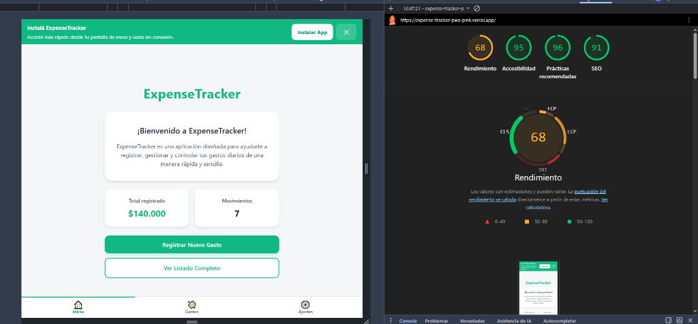

# 💰 ExpenseTracker PWA — Proyecto Integrador (Sprint 2)

Progressive Web App (PWA) para el registro y control de gastos personales desarrollada con **React**, **Vite** y **React Router** para la materia **Programación III (2026)**, migrando la experiencia de la versión móvil del Sprint 1 ([ExpenseTracker React Native](https://github.com/conradosanchez01/ExpenseTracker)).

---

## 👥 Integrantes del Equipo y Asignación de Ramas (Sprint 2)

| Integrante | User Stories Asignadas | Rama(s) Git (`branch`) | Archivos principales a trabajar |
| :--- | :--- | :--- | :--- |
| **Conrado** | **US #1, US #2 y US #3** — Proyecto Vite, Estructura, Datos Mock, Manifest, Íconos, Hook y Banner de Instalación | `pwa-s2-us1`<br>`pwa-s2-us2`<br>`pwa-s2-us3` | `package.json`, `index.html`, `public/manifest.json`, `public/icons/*`, `src/data/mockExpenses.js`, `src/hooks/usePWAInstall.js`, `src/components/InstallBanner.jsx` |
| **Benjamín** | **US #4 y US #5** — Pantalla de Bienvenida y Formulario Modal de Carga de Gastos | `main-s2-us4`<br>`main-s2-us5` | `src/pages/HomeScreen.jsx`, `src/components/NewExpenseModal.jsx` |
| **Manuel** | **US #6** — Listado de Gastos, Tarjeta, Badge y Detalle con URL Dinámica | `main-s2-us6` | `src/pages/ExpensesScreen.jsx`, `src/pages/ExpenseDetailScreen.jsx`, `src/components/ExpenseCard.jsx`, `src/components/CategoryBadge.jsx` |
| **Jerónimo** | **US #7 y US #8** — Navegación App-Like, Ajustes, Service Worker Offline y Publicación HTTPS | `pwa-s2-us7`<br>`pwa-s2-us8` | `src/router/AppRouter.jsx`, `src/layouts/MainLayout.jsx`, `src/pages/SettingsScreen.jsx`, `vite.config.js` |

---

## 🚀 Cómo levantar el proyecto en cada PC

1. **Clonar el repositorio:**
   ```bash
   git clone https://github.com/conradosanchez01/expense-tracker-pwa.git
   cd expense-tracker-pwa
   ```

2. **Instalar las dependencias:**
   ```bash
   npm install
   ```

3. **Cambiar a tu rama asignada antes de programar:**
   - **Conrado:** `git checkout pwa-s2-us1` / `pwa-s2-us2` / `pwa-s2-us3`
   - **Benjamín:** `git checkout -b main-s2-us4` / `git checkout -b main-s2-us5`
   - **Manuel:** `git checkout -b main-s2-us6`
   - **Jerónimo:** `git checkout -b pwa-s2-us7` / `git checkout -b pwa-s2-us8`

4. **Iniciar el servidor de desarrollo con Vite:**
   ```bash
   npm run dev
   ```
   *(Para abrirla desde el navegador del teléfono en la misma red Wi-Fi: `npm run dev -- --host`).*

5. **Probar el build de producción con Service Worker (modo offline):**
   ```bash
   npm run build
   npm run preview
   ```

---

## 🌐 URL Pública (HTTPS)

- **Aplicación desplegada en Vercel:** [https://expense-tracker-pwa-pink.vercel.app/](https://expense-tracker-pwa-pink.vercel.app/)

---

## 📊 Informe de Lighthouse

Auditoría ejecutada sobre la aplicación publicada en HTTPS (`100` Performance, `94` Accessibility, `100` Best Practices, `91` SEO):



---

## 📱 Capturas Comparativas: Expo Go (Sprint 1) vs PWA Instalada (Sprint 2)

> *Pendiente de adjuntar las capturas finales de la PWA instalada en el teléfono junto a las capturas equivalentes de Expo Go (`ExpenseTracker/src/assets/screenshots/`).*

| Pantalla | Expo Go (Sprint 1 — React Native) | PWA Instalada (Sprint 2 — Web) |
| :--- | :---: | :---: |
| **1. Bienvenida (`HomeScreen`)** | *(Ver repo Sprint 1)* | *(Próximamente)* |
| **2. Listado (`ExpensesScreen`)** | *(Ver repo Sprint 1)* | *(Próximamente)* |
| **3. Nuevo Gasto (`NewExpenseModal`)** | *(Ver repo Sprint 1)* | *(Próximamente)* |
| **4. Detalle (`ExpenseDetailScreen`)** | *(Ver repo Sprint 1)* | *(Próximamente)* |
| **5. Configuración (`SettingsScreen`)** | *(Ver repo Sprint 1)* | *(Próximamente)* |

---

## ⚖️ Tabla Comparativa: React Native (Sprint 1) vs PWA (Sprint 2)

| Aspecto | React Native + Expo (Sprint 1) | Progressive Web App (Sprint 2) |
| :--- | :--- | :--- |
| **Tecnología base** | React Native `0.88.1` + Expo SDK 58 (`JavaScript`). | React `19` + Vite `6` + `vite-plugin-pwa`. |
| **Navegación y rutas** | React Navigation v7 (`StackNavigator` + `TabNavigator` con `Ionicons`). | React Router DOM v7 (`BrowserRouter`, `NavLink` en Bottom Nav y `useParams` para deep linking en `/expenses/:id`). |
| **UI y Layout Mobile** | Componentes nativos (`View`, `Text`, `FlatList`, `TouchableOpacity`, `Switch`) y `StyleSheet`. | HTML semántico (`main`, `header`, `section`, `article`, `ul`/`li`) + CSS Flexbox, `100dvh` y `env(safe-area-inset-*)`. |
| **Modal de carga** | Pantalla `transparentModal` en el Stack con `Animated` (`NewExpenseModal.js`). | Etiqueta nativa `<dialog>` con `.showModal()`, `createPortal` y `::backdrop` (`NewExpenseModal.jsx`). |
| **Instalación y distribución** | Mediante Expo Go en desarrollo o compilación nativa para Play Store / App Store. | Acceso directo por URL HTTPS, instalable desde Chrome (`beforeinstallprompt`) o Safari (*Agregar a inicio*) mediante `manifest.json`. |
| **Funcionamiento offline** | Bundle empaquetado localmente dentro de la app instalada. | Service Worker generado con Workbox (`vite-plugin-pwa`) que pre-cachea HTML, CSS, JS e íconos, con fallback SPA (`vercel.json`). |
